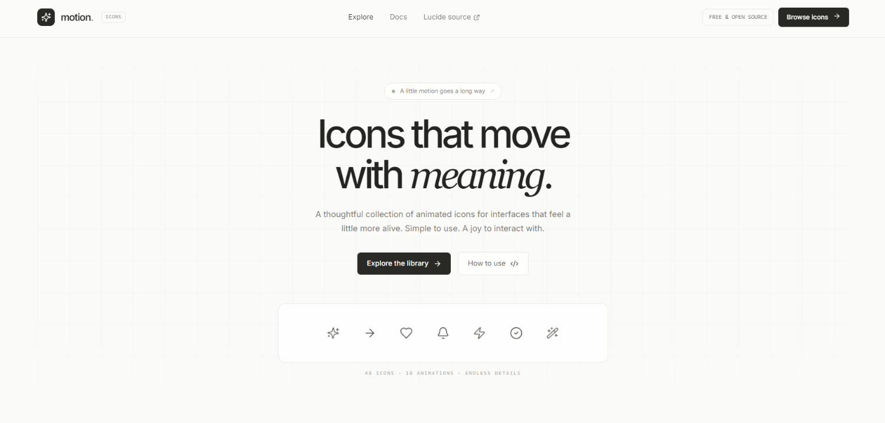
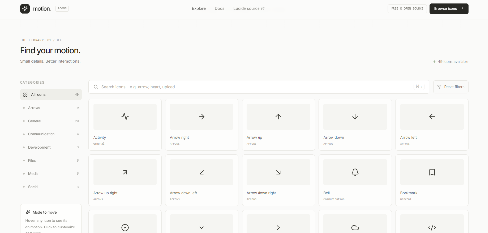
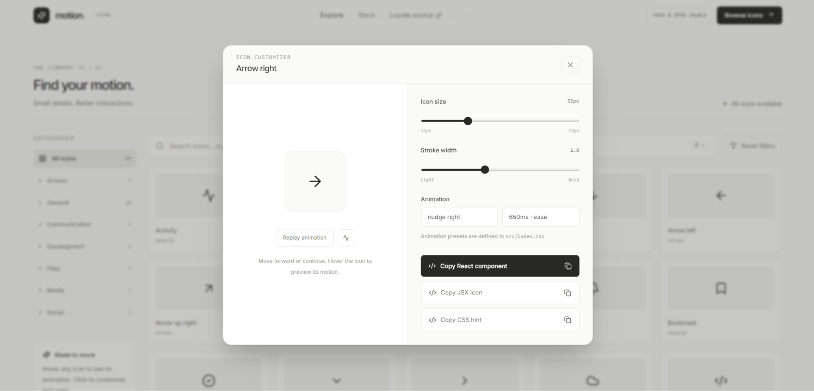
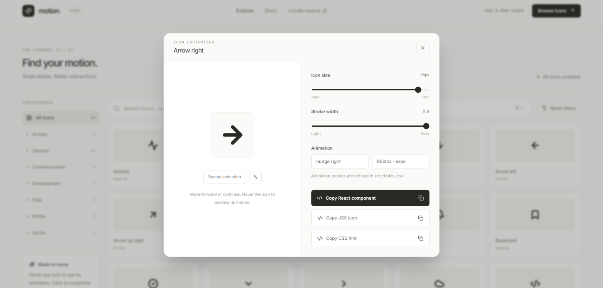

# Motion — Animated Icon Library

A minimalist animated icon library playground built with React, TypeScript, Vite, Tailwind CSS, and Lucide icons.

## Features
- Minimal light interface with responsive layout
- Search icons and filter by category
- Hover animations and an icon customizer panel
- Adjust icon size and stroke width
- Copy React/JSX snippets and CSS animation hints
- Reduced-motion accessibility support

## Getting started

Requirements: Node.js 18+

```bash
npm install
npm run dev
```

Open the local URL printed by Vite.

## Production build

```bash
npm run build
npm run preview
```

## Customize
- Add/edit icon entries in `src/App.tsx` in the `icons` array.
- Add or tune animation keyframes in `src/index.css`.
- Tailwind configuration lives in `tailwind.config.js`.

## Icon license
The sample icon components are from [Lucide](https://lucide.dev/), an open-source icon set. Review its license and attribution guidance before redistributing your own packaged icon library. This starter is inspired by the general icon-library browsing pattern and is not affiliated with Remix Icon.
# motion-icons

## Screenshot




